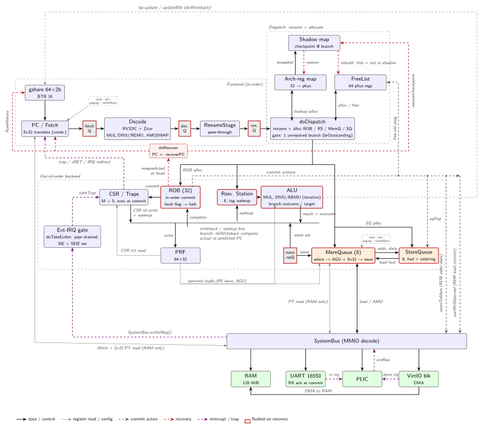

# Specula

Specula is an experimental single-issue out-of-order RV32 RISC-V core written
in Bluespec SystemVerilog. It renames registers, issues instructions out of
order, executes speculatively with branch prediction and recovery, and commits
in program order through a reorder buffer. It is simulated in Bluesim together
with models of a UART, PLIC and VirtIO block device, and it boots xv6-rv32 to
an interactive shell in simulation. Vivado synthesis has been run; the design
has not been placed, routed or run on an FPGA.

## Architecture



Specula fetches, decodes, renames, dispatches, issues, executes and commits one
instruction per cycle. Fetch is steered by a gshare predictor (64-entry 2-bit
PHT, 6-bit history) and a 16-entry BTB; JAL and JALR are predicted, and only one
control-flow instruction is unresolved at a time. Rename maps 32 architectural
registers onto 64 physical registers (`PRF.bsv`) using a free list with a grouped
priority picker and a single rename-map checkpoint. Dispatch allocates a 32-entry
reorder buffer slot and sends ALU work to an 8-entry reservation station
(tag-broadcast wakeup, lowest-index-ready issue) and loads/stores to an 8-entry
memory queue. The ALU holds the integer unit, a multiplier registered in the
DSP48 output stage, and an iterative divider (DIVU/REMU).

Memory operations go through a select / address-generation / issue split, oldest
ready first. An 8-entry store queue forwards to loads per byte lane, a load waits
until every older store address is known, and stores write memory only at commit.
Addresses are translated by Sv32 (two-level walker) and routed by the system bus
to RAM, a 16550-style UART (keystrokes come from `uart_rx.in`), a PLIC, and a
VirtIO block device with a DMA engine that backs the xv6 filesystem.

The ROB commits in order. Page faults are recorded on the speculative
instruction and resolved at commit, where they halt the simulation instead of
trapping to S-mode; a mispredicted branch is acted on at the ROB
head and flushes the backend, restoring the rename map and rebuilding the free
list. CSRs cover machine and supervisor mode (ECALL, MRET, SRET, trap delivery);
the PLIC raises a supervisor external interrupt that is taken only once the
pipeline has drained.

## Verification status

Results below were reproduced in Bluesim.

- Standalone benches (5, all pass): `make rvctest csrtest uarttest mmutest
  virtiotest`.
- Directed programs (16, all pass): `sw/test.c` and the 15 programs in
  `sw/tests/`. Each reports `TEST PASSED (tohost = 1)`. Select one with
  `make TEST=sw/tests/<file> RV_ARCH=<arch> run`; the `RV_ARCH` needed is
  `rv32i`, `rv32i_zicsr`, `rv32im_zicsr` or `rv32ima_zicsr` depending on the
  test.
- xv6-rv32: the kernel boots, starts `init` and `sh`, and a scripted
  session (`mkdir`, `ls`, `echo > file`, `cat`, `rm`, `ls`) runs against the
  VirtIO-backed filesystem. Keystrokes come from `uart_rx.in` through the
  modeled UART. The run is stopped by the 300M-cycle watchdog, not by a clean
  exit. `make interactive` runs it with live input.

## Synthesis

```sh
make vivado-syn
```

Target device is the Xilinx `xc7a35tcpg236-1` at 90 MHz. All numbers are
synthesis-only estimates.

| Clock | WNS | LUT | FF | DSP |
|---|---|---|---|---|
| 90 MHz | +0.996 ns | 19,499 (93.75%) | 12,466 | 3 |

## Repository layout

```
Makefile                        build rules
sw/                             RV32 test programs and directed tests
syn/                            Vivado synthesis script, constraints, top wrapper
src/
  SpeculaCore.bsv               top-level core, wires the pipeline together
  common/Common.bsv             shared types and instruction decode
  frontend/
    FetchUnit.bsv               instruction fetch (Sv32-translated)
    DecodeUnit.bsv              instruction decode
    BranchPredictor.bsv         gshare + BTB predictor
    RVCExpand.bsv               compressed-instruction expander
    InOrderCore.bsv             older standalone in-order core
  backend/
    RenameStage.bsv             register renaming and architectural map
    RAT.bsv                     register-alias table module
    FreeList.bsv                physical-register free list
    PRF.bsv                     physical register file
    ReservationStation.bsv      out-of-order issue queue
    ROB.bsv                     reorder buffer (in-order commit)
    ALU.bsv                     integer ALU, multiplier, divider
    LSU.bsv                     store queue and load/store helpers
    MemQueue.bsv                memory-operation queue
    CSRFile.bsv                 machine/supervisor CSRs and traps
    MMU.bsv                     Sv32 address translation
    SystemBus.bsv               MMIO decode (RAM, UART, PLIC, VirtIO)
    Uart.bsv                    16550-style UART model
    Plic.bsv                    platform interrupt controller
    VirtioStub.bsv              VirtIO block device model
docs/                           design notes and the pipeline diagram
```

## Build and run

Requires `bsc` (Bluespec) and, for the C/assembly tests, `riscv32-unknown-elf-gcc`.

```sh
make                 # build build/sim (bsc compile + elaborate)
make run             # build and run sw/test.c, reports tohost pass/fail
make clean           # remove build outputs
```

Directed tests and benches:

```sh
make rvctest csrtest uarttest mmutest virtiotest         # standalone benches
make TEST=sw/tests/m4.c run                               # one program (RV_ARCH=rv32i default)
make TEST=sw/tests/m8_muldiv.S RV_ARCH=rv32im_zicsr run   # RV_ARCH per test: rv32i | rv32i_zicsr
                                                          #   | rv32im_zicsr | rv32ima_zicsr
make disasm TEST=sw/tests/m4.c                            # disassemble a test
```

xv6-rv32 needs `../xv6-rv32/kernel/kernel` and `../xv6-rv32/fs.img` (not in this
repo; override with `FS_IMG=`):

```sh
make interactive     # boot xv6 with live keyboard input through the UART
```

Verilog and synthesis:

```sh
make verilog         # bsc -> build/vlog/mkSpeculaCore.v
make vivado-syn      # synth_design for xc7a35t, reports in build/vivado/
```